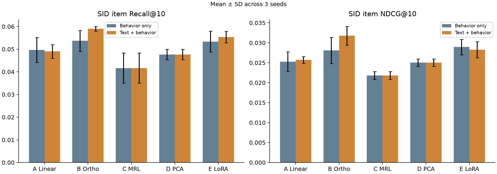

# EmbeddingGemma 2 → 128d → SID 推荐实验

在 RTX 5070 Laptop 8 GB 上，对比五种 128 维商品表示与两种第一阶段训练设置。骨干为固定版本的 EmbeddingGemma 2 文本塔，下游为相同设置的 RQ-VAE 和小型 GRU 自回归 SID 推荐器。

**本轮建议优先保留 B：正交矩阵＋普通文本混合训练。** 这是一个固定短预算、单一 Beauty 数据集的筛选结果，不能视为完整 SpecMRL/TIGER 复现或充分收敛结论。

## 实验结果

2026-10-29—30，本机实际运行；3 个随机种子 `0/1/2`，相同 1,000 位测试用户。表内为三种子均值，标准差及配对区间见完整结果。

| 方案 | 仅协同 Recall@10 | 仅协同 NDCG@10 | 文本＋协同 Recall@10 | 文本＋协同 NDCG@10 |
|---|---:|---:|---:|---:|
| A：冻结骨干＋线性头 | 4.97% | 0.02529 | 4.90% | 0.02571 |
| B：冻结骨干＋128 个正交方向 | 5.37% | 0.02808 | **5.90%** | **0.03176** |
| C：冻结原生 MRL 前缀 | 4.17% | 0.02181 | 4.17% | 0.02181 |
| D：商品内容 PCA128 | 4.77% | 0.02502 | 4.77% | 0.02502 |
| E：骨干 LoRA＋128 维前缀 | 5.33% | **0.02895** | 5.53% | 0.02826 |



- B 的混合设置相对自身仅协同设置，NDCG 提高 **13.1%**，三个种子均提升；配对用户 95% 区间为 `[+0.00028, +0.00712]`。
- A/B/E 的混合设置均提高了独立普通文本验证集上的 128 维检索 NDCG，但推荐收益并不普遍成立。
- B 与 LoRA 的推荐差异区间包含零，尚不足以证明 B 的结构本身优于 LoRA。LoRA 单次第一阶段约 9–14 分钟，B 在复用冻结缓存后约 5 秒；共享缓存的首次编码成本另计。
- C/D 按预先确认的设计作为固定参照，在两个设置间复用相同检查点和预测，并未接受与 A/B/E 相同的第一阶段监督。

## 结果入口

- [五方案 × 两种设置的完整 HTML 报告](results/experiment2/report.html)（下载仓库后用浏览器打开；GitHub 文件页显示 HTML 源码）
- [逐种子 CSV](results/experiment2/summary.csv) · [均值和配对区间 JSON](results/experiment2/aggregate.json)
- [30 个条件的原始运行核验](results/experiment2/verification.json) · [六个 LoRA 适配器回读核验](results/experiment2/adapter_reload_verification.json)
- [原始运行配置、环境与输入校验和](results/experiment2/run_manifest.json)
- [第一轮 A/B/C 实验](results/experiment1/report.html)：历史向量均值监督，训练预算不同，和第二轮分开解释。

## 方法与数据

| 方案 | 第一阶段更新内容 | 输出方式 |
|---|---|---|
| A | 带偏置 `Linear(768,128)`，98,432 参数 | 线性变换后归一化 |
| B | 原始 `768×128` 矩阵，98,304 参数 | 可微 QR 得到正交列，再投影、归一化 |
| C | 无 | 原生前 128 维，重新归一化 |
| D | 无梯度；拟合商品内容的 PCA | 中心化、不白化的 PCA128，归一化 |
| E | 所有 24 个文本层的 `q_proj/v_proj` LoRA，524,288 参数 | 原生输出前 128 维，归一化 |

推荐数据为 **Amazon 2014 Beauty 5-core**。评分 ≥4、去重、长度过滤后为 14,993 位用户、12,069 件商品、130,455 次交互。每用户最后两次交互分别作验证和测试。商品文本只使用标题、品牌、类别、描述。

普通文本来自 SpecMRL 指定的 [KaLM-embedding-finetuning-data](https://huggingface.co/datasets/KaLM-Embedding/KaLM-embedding-finetuning-data)，固定 revision `e9443ab6f5d4dc29c79cea03834e932428ed6ab1`。选取 Quora、SNLI 和 MS MARCO 的官方文件，固定抽样 8,192 条训练、768 条独立验证，记录源文件及样本校验和。这不是论文的百万样本完整训练配方。

第一阶段推荐样本为 8,192 个训练窗口：最近最多 10 件商品的标题按先后顺序组成查询，下一商品内容为正例。A/B/E 使用相同的查询—文档对比目标、有效 batch=32、温度 0.1 和一轮固定训练。混合设置交替加入同量普通文本，所以推荐样本曝光量相同、**优化步骤从 256 增至 512**；收益包含额外训练的作用。

第一阶段结束后冻结表示，再独立训练 RQ-VAE 和 GRU；下游损失不会反向更新表示。RQ-VAE 为 `128→64→32`、3×256 码字、10 轮预热＋15 轮量化训练；追加碰撞后缀形成唯一四 token SID。GRU 使用最多 60,000 个训练窗口、历史长度 10、5 epochs，验证 CE 选检查点。测试采用全目录合法 SID、beam=30 的近似搜索，过滤已见商品。

## 复现

见 [完整运行步骤](docs/REPRODUCING.md)。只重新计算已发布结果，不需要下载模型或数据：

```powershell
python check_published_results.py
python reproduce_report.py
```

需要相应 Python 依赖，但不要求 GPU。完整重新训练需 CUDA PyTorch、已有的固定模型快照，以及公开数据下载；Windows 上实测 Python 3.12、PyTorch 2.11.0+cu128。精确版本见 `requirements-experiment2.lock.txt`。

## 仓库结构与保留范围

```text
*.py                        训练、下载、汇总及核验入口
docs/REPRODUCING.md          从下载到训练的完整步骤
results/experiment1/        第一轮 A/B/C 结果快照
results/experiment2/        五方案、两种设置的结果快照
data/kalm/manifest.json     数据来源、版本、数量和校验和
provenance/executed_source/ 原始实际执行代码，保留源哈希可核对
provenance/EXPORT.json      整理与匿名化说明
```

仓库不包含预训练权重、训练检查点、原始评论/商品数据、KaLM 文本/Parquet、向量缓存或虚拟环境。逐用户结果保留稳定匿名编号及 Recall/NDCG，足以重算配对统计；详细商品预测留在原本机工作目录。核验 JSON 记录的是原始完整运行的检查结果，`check_published_results.py` 核对的是本仓库发布快照。

根目录执行入口仅将模型路径改为环境变量 `EMBEDDINGGEMMA2_MODEL`；原始实际执行文件保存在 `provenance/executed_source`。原始运行清单中的本机路径属于历史记录，不是新机器必须使用的目录。

## 解释边界

- B 是直接正交矩阵，不是 SpecMRL 参数谱的完整复现；推荐器是小型 GRU，不是完整 TIGER/T5。
- C/D 为固定参照，不能将 A/B/E 对它们的提升完全归因于结构。
- 用户内时间切分不是全局严格因果切分；PCA/RQ-VAE 使用全目录可见商品内容，具有传导性。
- 最大 192 tokens；2,206/8,192 条推荐训练查询被右截断，可能丢失较晚的历史标题。详见 [长度审计](results/experiment2/tokenization_audit.json)。
- 配对区间重采样用户，并不覆盖训练种子总体不确定性；多个比较未做多重检验校正。

## 来源

- [SpecMRL 论文](https://arxiv.org/abs/2610.26824) · [官方代码](https://github.com/CentreChen/spec-mrl)，参考版本 `59db2450bc1cf386f30413a3de32dbe82b47bbd0`
- [EmbeddingGemma 2 官方实现说明](https://huggingface.co/docs/transformers/model_doc/embedding_gemma2)，模型固定版本 `f9972ac22e696a105c482202646979e33e4b5a1e`
- [KaLM 数据](https://huggingface.co/datasets/KaLM-Embedding/KaLM-embedding-finetuning-data)

